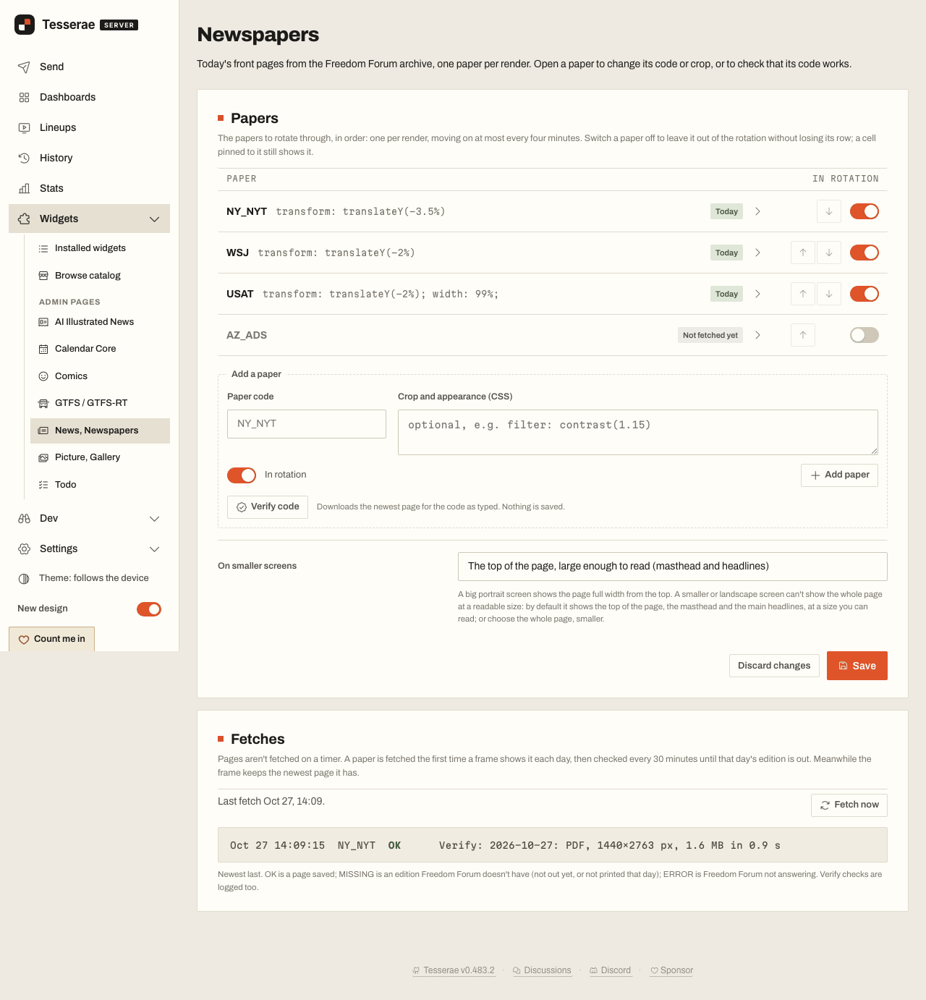

# News, Newspapers

Today's newspaper front pages from the
[Freedom Forum](https://frontpages.freedomforum.org) archive, one paper per
render, on a Tesserae panel.


## What it does

- **Rotates through your papers.** The list lives on the widget's admin page
  (Widgets, News, Newspapers). Each render shows the next paper in the
  rotation; a cell can instead be pinned to one paper in its Paper option.
- **A paper's own CSS.** Each row has optional CSS (a few declarations such as
  `transform: translateY(-3.5%)` or `filter: contrast(1.15)`) applied to that
  paper's page image only. Anything outside a small, closed vocabulary is
  dropped.
- **Sharp pages, from the PDF.** Each page is drawn from the paper's own PDF
  at the panel's width, so body text stays readable on a big panel (see
  [How pages are drawn](#how-pages-are-drawn)).
- **Pages download in the background**, so a render never waits on the
  network. A paper that isn't out yet shows its last good page, up to 30
  days old, and the worker tries again with a backoff.
- **Admin page extras:** a Verify button per row (checks a paper code and
  shows a thumbnail), a Fetch now button, and a log of what the worker did.



## How pages are drawn

Freedom Forum publishes each front page as a PDF and as a JPEG about 700 px
wide. The JPEG alone is an upscale on a 1440 px panel and its body text is a
blur, so the widget fetches both and draws the PDF:

- **In the panel's browser, with PDF.js.** The worker keeps the PDF beside
  the JPEG in the widget's data folder. When the panel's frame is rendered,
  `client.js` loads the bundled [PDF.js](https://mozilla.github.io/pdf.js/)
  (in a worker), draws page one onto a canvas at the cell's own pixel width
  (times the device pixel ratio) and applies the paper's CSS to it, as it
  would to the JPEG. The frame is captured only once the drawing is
  complete. On an Apple-silicon Mac, loading and drawing the New York Times'
  4.4 MB PDF 1440 px wide takes about 0.5 s, the Wall Street Journal's about
  0.3 s; expect several seconds on a Raspberry Pi (not measured there).
  Nothing is cached between renders (the host offers widgets no place to
  keep a picture drawn in its browser), so every render draws it again.
- **The JPEG stands in** when there is no PDF yet (it is asked for again on
  a backoff, a few times a day), PDF.js can't draw it, or drawing would take
  longer than 15 seconds.
- **On the server, if pypdfium2 is there.** Where the Python package
  `pypdfium2` happens to be installed on the host (this widget never asks
  for it), the worker draws the PDF itself, 1440 px wide, in a child process
  with time, CPU and memory limits, and the panel gets that picture with no
  PDF.js work at all.

PDFs are capped at 30 MB, a slot holding last month's file is refused, and
only each paper's newest PDF is kept.

## Settings

No API key and no Settings > Widgets entries. The paper list and the
"On smaller screens" choice are kept in the widget's own `config.json` in its
data folder, edited on the admin page.

| Cell option | Notes |
| --- | --- |
| Paper | Empty rotates through the admin list; a paper code (for example `NY_NYT`) pins the cell to it. |

The rotation moves at most once every four minutes, so a send prepared ahead
of time and its follow-ups show one paper. Two sends inside four minutes show
the same paper twice.

## Network

Only `cdn.freedomforum.org` (the page PDFs and images) and
`frontpages.freedomforum.org` (the paper list for the picker), both declared
in `plugin.json`.

## Host helpers

`app.plugin_http` (the paper list) and, when present, `app.jobs` (the
background job tray). Nothing else from the host beyond the plugin contract:
PDF.js is served from the widget's own `static/` folder, and the pages and
PDFs from its own route.

## Tests

The tests run against a checkout of Tesserae `main`. Copy this folder in as
`plugins/news_front_pages` (a copy, not a symlink: the widget takes its id from
its folder name) and run from the checkout root:

```sh
python -m pytest plugins/news_front_pages/tests
```

They never touch the network. The browser tests (the admin page, and
`client.js` drawing a PDF it is given, falling back to the JPEG) need
Playwright's Chromium and skip themselves without it; the client check needs
`node`; the server-side drawing tests need `pypdfium2`. To also draw today's
real New York Times PDF, downloaded when the test starts:

```sh
NEWS_FRONT_PAGES_LIVE_PDF=1 python -m pytest plugins/news_front_pages/tests/test_client_browser.py
```

## Licence

AGPL-3.0, see [LICENSE](LICENSE).

Bundled: [PDF.js](https://github.com/mozilla/pdf.js) 6.4.299 by Mozilla,
Apache License 2.0, in [`static/pdfjs`](static/pdfjs) with its licence and
the licences of the image decoders, colour profile and CMaps it comes with
(see [`static/pdfjs/README`](static/pdfjs/README)).
